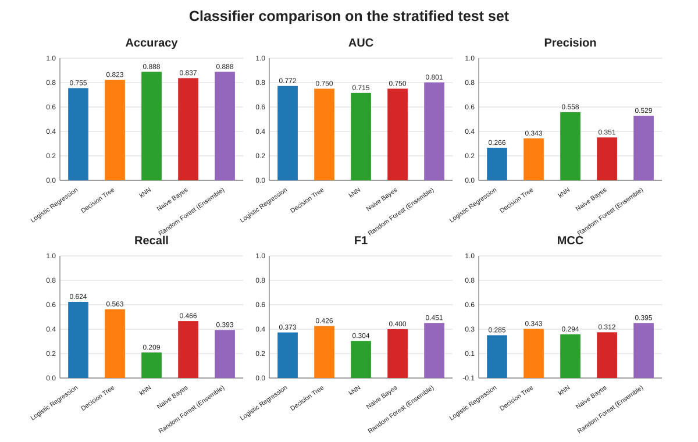

# ML Assignment 2 – Classification on the Bank Marketing Dataset

**Name:** Sebastin  
**BITS ID:** 2026ct05199  
**Email:** [2026ct05199@wilp.bits-pilani.ac.in](mailto:2026ct05199@wilp.bits-pilani.ac.in)  
**Programme:** M.Tech (AIML/DSE) – Machine Learning

## Problem statement

For this assignment I chose the Bank Marketing dataset from the UCI repository. It comes from direct phone campaigns run by a Portuguese bank. Each row is one customer who was called. It has 16 details about the customer and the call, such as age, job, marital status, education, account balance, loans, call duration and the outcome of the previous campaign. Call duration is in the data, but I excluded it from the models because it is only known after the call. The target column y says whether the customer subscribed to a term deposit (yes or no).

So this is a binary classification problem with 45,211 records. The goal is to predict whether a customer will subscribe, so the bank can focus its calls on the customers most likely to say yes. This saves time and cost, and it avoids bothering customers who are not interested.

I picked this dataset because it is a real business problem. It has a mix of numeric and categorical features, and it is imbalanced: only about 12% of customers subscribed. That makes it a good case for seeing why accuracy alone is not enough.

I used the same dataset and the same stratified 80:20 train/test split (random_state = 42) for all five models, so the comparison is fair. The models are Logistic Regression, Decision Tree, kNN, Naive Bayes and Random Forest. I compared them using Accuracy, AUC, Precision, Recall, F1 and MCC.

## Dataset description [1 mark]

- **Dataset:** Bank Marketing (`bank-full.csv`)
- **Source:** [UCI Machine Learning Repository](https://archive.ics.uci.edu/dataset/222/bank+marketing)
- **Target:** `y` (`yes` / `no`), whether a client subscribed to a term deposit.
- **Dataset size:** 45,211 rows and 16 original input features.
- **Feature types:** 7 numeric and 9 categorical features in the source dataset.
  `duration` is excluded from prediction because it is only known after the call;
  `previously_contacted` is engineered from the `pdays` sentinel.
- **Duplicates:** 0 exact duplicate rows were found.
- **Missing-value handling:** `job` has 288 `unknown` values and `education` has
  1,857; these are treated as missing and imputed within the training-fitted
  pipelines. `unknown` in `contact` and `poutcome` is retained as a category.
  A `pdays` value of `-1` indicates no previous contact and is handled with a
  separate indicator feature.
- **Class distribution:** `no` = 39,922 (88.30%); `yes` = 5,289 (11.70%);
  imbalance ratio (`no:yes`) = 7.55:1.

## GitHub Repository Link [2 marks]

[https://github.com/2026CT05199/ML-assignment-2](https://github.com/2026CT05199/ML-assignment-2)

## Execution instructions

1. Use Python 3.9 or newer.
2. Keep `bank-full.csv` in the project root. The notebook reads this local file
   and falls back to the GitHub copy
   (`https://raw.githubusercontent.com/2026CT05199/ML-assignment-2/main/bank-full.csv`)
   if the local file is not found.
3. From the project root, install dependencies:
   `python -m pip install -r requirements.txt`
4. Run the notebook `2026ct05199_ML_Assignment_2.ipynb` (Restart & Run All), or run
   the script: `python model/assignment.py`
5. The run creates the stratified test split, trains the five classifiers, and
   writes the generated files listed below.
6. The notebook was also run from a fresh kernel on BITS Virtual Lab; the
   screenshots are in the submission PDF.

The split is 80:20 with `random_state=42` and stratification. The recorded
notebook run contains 36,168 training rows and 9,043 test rows; the positive
class rate is 11.70% in both. Imputation, one-hot encoding, and model-specific
scaling are inside pipelines fitted on training data only.

## Models used [5 marks]

The brief explicitly names five classifiers. The notebook, script, and reported
results use those five.

| Model | Configuration |
|---|---|
| Logistic Regression | `class_weight="balanced"`, `max_iter=1000`; scaled numeric features |
| Decision Tree | `class_weight="balanced"`, `max_depth=10`, `min_samples_leaf=5` |
| K-Nearest Neighbors | `n_neighbors=7`, distance weights; scaled numeric features |
| Gaussian Naive Bayes | `GaussianNB`; dense one-hot features and scaled numeric features |
| Random Forest (Ensemble) | 300 trees, `class_weight="balanced_subsample"`, `min_samples_leaf=2` |

## Results and comparison [5 marks]

The following values are from the 20% test-set results.

| ML Model Name | Accuracy | AUC | Precision | Recall | F1 | MCC |
|---|---:|---:|---:|---:|---:|---:|
| Logistic Regression | 0.7548 | 0.7722 | 0.2662 | 0.6238 | 0.3732 | 0.2853 |
| Decision Tree | 0.8225 | 0.7502 | 0.3427 | 0.5633 | 0.4262 | 0.3427 |
| kNN | 0.8881 | 0.7153 | 0.5581 | 0.2089 | 0.3040 | 0.2937 |
| Naive Bayes | 0.8367 | 0.7502 | 0.3509 | 0.4660 | 0.4003 | 0.3121 |
| Random Forest (Ensemble) | 0.8880 | 0.8012 | 0.5286 | 0.3932 | 0.4509 | 0.3954 |

### Metric visualization [2 marks]

The script generates metric comparison charts at
[`outputs/metric_comparison.png`](outputs/metric_comparison.png) and
[`outputs/metric_comparison.svg`](outputs/metric_comparison.svg).

## Observations [3 marks]

Only about 12% of customers subscribed, so accuracy alone is misleading: always predicting "no" would already give about 88%. I therefore compared the models on all six metrics.

| Model | Observation |
|---|---|
| Logistic Regression | Highest recall (0.62) but lowest precision (0.27) and accuracy (0.75). It catches many buyers but makes many false "yes" predictions. |
| Decision Tree | Balanced trade-off (recall 0.56, F1 0.43) and easy to interpret, but its AUC (0.75) is below Random Forest's. |
| kNN | Accuracy is high (0.888), but recall is only 0.21 and F1 is 0.30, so it misses most buyers. It also has the lowest AUC (0.72). |
| Naive Bayes | Middling results (F1 0.40, MCC 0.31). Its independence assumption is probably not realistic for this data. |
| Random Forest (Ensemble) | Best AUC (0.80), F1 (0.45) and MCC (0.40), with accuracy of about 0.89. Combining many trees gave the most reliable result. |

Random Forest gave the best overall results. A bank that wants to catch as many likely buyers as possible could choose Logistic Regression for its higher recall. If it wants fewer wasted calls, a higher-precision model is better.

## Generated project files

- `model/assignment.py` — experiment source
- `model/*.joblib` — fitted model pipelines generated by the run
- `requirements.txt` — Python dependencies
- `test_data.csv` — stratified holdout data with labels
- `outputs/results.csv` — measured test-set metrics
- `outputs/metric_comparison.png` and `outputs/metric_comparison.svg` — metric visualizations
- `README.md` — project and experiment documentation

